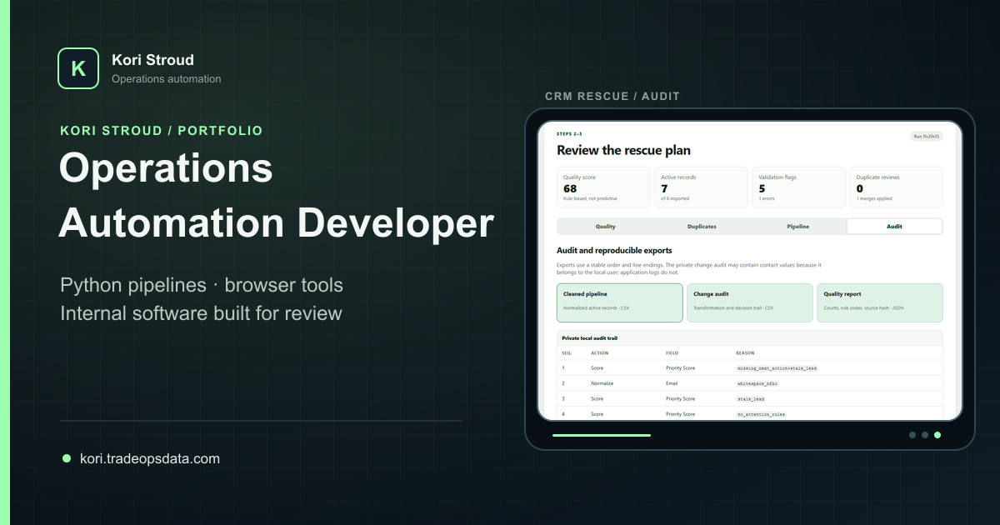

# Kori Stroud — Operations Automation Portfolio

Source for [Kori Stroud's operations automation portfolio](https://kori.tradeopsdata.com), including three project case studies and a focused services path. The site is static, tracker-free, keyboard-friendly, responsive, and built around truthful evidence from synthetic or sanitized project demonstrations.

## 1. What problem it solves

Recruiters and small operations teams need more than a list of technologies. This portfolio shows what each tool is for, how an operator moves through it, which decisions stay human, and what the local verification actually established. It keeps engineering evidence visible without presenting synthetic demonstrations as customer outcomes.

## 2. Representative preview



The public routes use one shared visual system while each project and service has its own social-preview card and route-specific metadata.

## 3. What it does

- Presents case studies for CRM Rescue, ATS Copilot, and the sanitized TradeOps Data demo.
- Explains each problem, audience, workflow, useful features, human decision points, product screens, verification, and current scope.
- Offers a fixed-scope Automation Fix Sprint and direct professional contact paths.
- Exposes canonical trailing-slash routes, route identity markers, a branded 404, sitemap, robots policy, and route-specific social metadata.
- Uses finite, replayable interface demonstrations that respect reduced-motion preferences.

## 4. How the workflow proceeds

1. A visitor starts with the business problem on the home page or a case study.
2. The case study walks through the real operator sequence in order.
3. Human approval boundaries and synthetic-data labels stay next to the relevant evidence.
4. Reviewed screenshots and verification notes show what was actually tested.
5. The visitor can inspect the corresponding public source or contact Kori about a workflow or role.

## 5. Stack and architecture

- React 19 and TypeScript
- Next-compatible Vinext routing and metadata
- Vite production build with a Cloudflare Worker-compatible ESM entry
- Static route export under `dist/client` for Nginx hosting
- Plain CSS with shared tokens, responsive breakpoints, visible focus states, and reduced-motion handling
- Sharp-based deterministic 1200×630 social-card generation using reviewed local project imagery

The deployed site is static. It has no application database, authentication, analytics, advertising pixels, contact form, or visitor-tracking service. Client JavaScript is limited to presentation interactions such as menu state, replay controls, image viewing, and copying the public email address.

## 6. How to run it

Requires Node.js 22.13 or newer.

```powershell
npm ci
npm run dev
```

Open the local URL printed by Vite. To create the production export:

```powershell
npm run build
```

## 7. How to verify it

Run the complete local release gate:

```powershell
npm run social-cards:verify
npm run release-check
```

The checks cover deterministic social cards, TypeScript, lint, all server-rendered and static routes, canonical links, route identity, social metadata uniqueness, screenshot presence, privacy patterns, responsive/reduced-motion safeguards, the production build, and the production dependency audit. GitHub Actions runs the same gates on Node 22.

For production-like local routing after a build:

```powershell
node scripts/static-preview.mjs
```

## 8. Privacy and safety boundaries

- Public screenshots use invented or sanitized records.
- No visitor input is collected or stored.
- Contact buttons open a pre-addressed email draft; nothing sends automatically.
- No analytics, tracking, advertising pixels, authentication, or hidden submission endpoint is present.
- The full TradeOps operational repository and its private data are not part of this repository.
- ATS Copilot never submits applications, and CRM Rescue requires explicit duplicate decisions.

## 9. Current scope and limitations

- This repository is the portfolio presentation, not a hosted copy of the three underlying products.
- The site is a static export rather than a CMS or multi-user application.
- Accessibility checks cover the automated and reviewed states described in the tests; they are not a formal certification.
- Deployment is a separate manual operation. Building or testing this repository does not deploy the live site.
- Copyright is reserved; publication for portfolio review does not grant permission to reuse the source or assets.

## 10. Portfolio case studies and contact

- [Live portfolio](https://kori.tradeopsdata.com)
- [CRM Rescue case study](https://kori.tradeopsdata.com/projects/crm-rescue/)
- [ATS Copilot case study](https://kori.tradeopsdata.com/projects/ats-copilot/)
- [TradeOps Data case study](https://kori.tradeopsdata.com/projects/tradeops/)
- [Services](https://kori.tradeopsdata.com/services/)
- [Email Kori](mailto:kori@tradeopsdata.com)
- [LinkedIn](https://www.linkedin.com/in/koristroud/)

